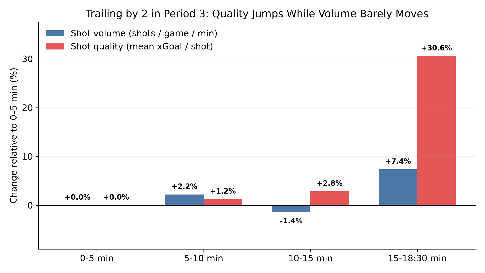
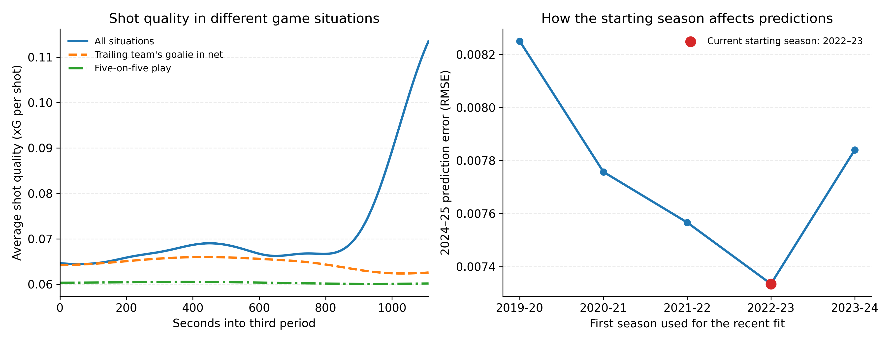
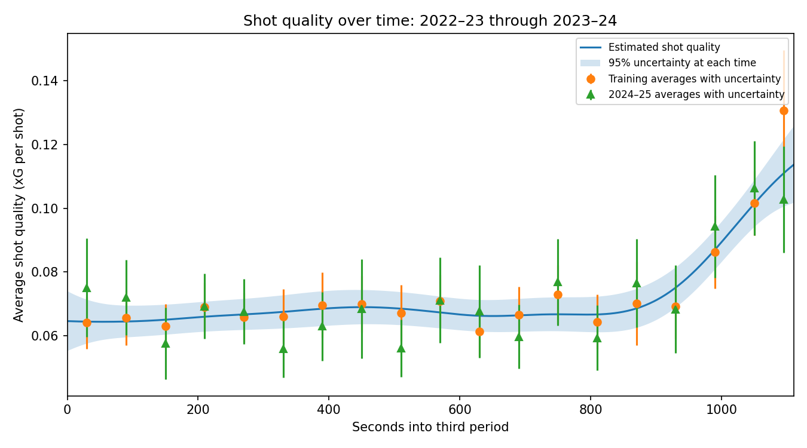
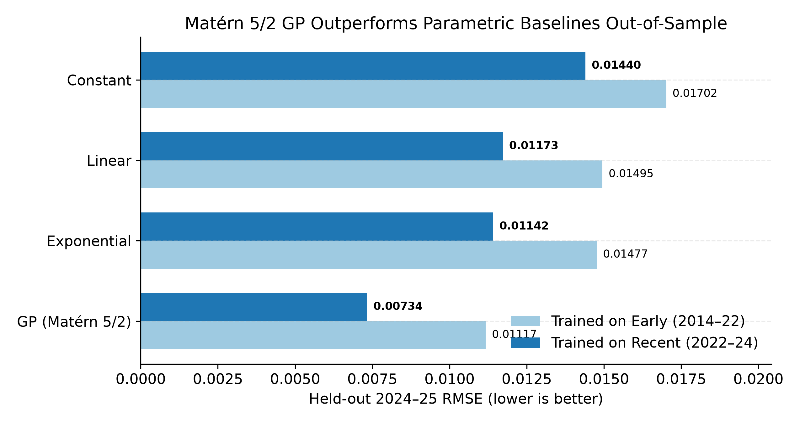

# hockeybayes

Gaussian process regression for NHL shot quality when a team trails by two goals in the third period.

This repository examines how expected goals per shot (`xGoal` from MoneyPuck) change over the first 18:30 of the third period, and how well models fit to earlier seasons predict the held-out `2024–25` season.

## Study sample and data checks

The published results below use MoneyPuck shot-level CSVs from `2014–15` through `2024–25`. The default split is saved in `configs/study.json`. You can choose different seasons when running the project; each run saves its own report and figures.

`filter_shots` in `src/analysis.py` keeps unblocked shot attempts taken by the trailing team when the score difference is two goals in period 3, from `0:00` through `18:30` elapsed (`1110` seconds). It checks column presence, integer-valued scores and periods, `xGoal` bounds in `[0, 1]`, valid team codes, and unique `(game_id, shotID)` pairs within each season.

The configured split assigns:
* `2014–15` through `2021–22` (`early`): 33,252 shots across 4,690 games
* `2022–23` through `2023–24` (`recent`): 9,842 shots across 1,336 games
* `2024–25` (`validate`, held out): 4,909 shots across 692 games

## Methods

* **Window decomposition (`src/decomposition.py`):** Summarizes shot counts and mean `xGoal` across four clock windows (`0–5 min`, `5–10 min`, `10–15 min`, `15–18:30 min`), normalized by clock-window duration (`5.0`, `5.0`, `5.0`, `3.5` minutes).
* **Cluster bootstrap (`src/analysis.py`):** Resamples whole games within each season (`2000` replicates) to estimate bin-level sampling variances (`se_sq`) while preserving within-game shot correlation.
* **Gaussian process regression (`src/GP_regression.py`):** Fits a Matérn 5/2 kernel with a constant scale and `WhiteKernel` to one-minute bin means (`19` bins through `18:30`), passing rescaled bootstrap variances via `alpha`.
* **Baseline comparisons (`src/results.py`):** Evaluates `Constant`, `Linear`, and `Exponential` weighted-least-squares baselines alongside the GP on the held-out `2024–25` bins, and computes posterior derivative-ratio (`f'/f`) summaries.
* **Manpower and era checks (`src/talk_sensitivity.py`):** Stratifies the GP fits by game state (all situations, goalie-in-net, and 5v5 even strength), checks held-out error across alternative `recent`-era start seasons (`2019–20` through `2023–24`), extracts fitted kernel hyperparameters, and writes four presentation figures.

## Why a Gaussian process?

The shape of the time trend is part of the question. A straight line assumes the same rate of change throughout the period, while an exponential curve ties the rate of change to the current level. A GP lets the fitted curve stay fairly flat for part of the period and bend more sharply later. It also allows decreases; the model does not impose the original hypothesis that shot quality should rise as time runs out.

Each era has only 19 bin means, with different amounts of sampling uncertainty. The GP uses that uncertainty when fitting the curve, so an imprecise bin has less influence. Fitting at this scale is inexpensive, and the posterior gives uncertainty around the estimated trajectory. Those intervals remain conditional on the chosen kernel and fitted hyperparameters.

The held-out comparison provides some support for this choice: the recent-era GP has lower prediction error than the fitted parametric baselines on 2024–25. One held-out season is limited evidence, especially when the era boundary has also been examined against that season.

## Why the Matérn 5/2 kernel?

The kernel describes how strongly shot-quality estimates at different times are related. Matérn 5/2 assumes a smooth underlying curve with two mean-square derivatives. That is a reasonable working assumption for averages over many games: neighboring minute bins should usually carry information about each other, while the rate of change can vary through the period. The smoothness assumption also supports the derivative analysis used here.

The length scale sets how far that relationship extends in time. It is estimated from the training data by marginal likelihood, within bounds of 30 to 1,000 seconds. The fitted values are about 175 seconds for the early era and 318 seconds for the recent era. These describe the smoothness of the aggregate curves; they should not be interpreted as the duration of a team's tactical response.

The constant kernel scales the size of variation in the curve. The added white-noise term allows residual variation beyond the supplied bootstrap sampling variances. Matérn 5/2 is a modeling choice: the current baseline comparison does not establish that it is the best kernel. Comparing other smoothness settings on additional held-out seasons would give a firmer basis for that choice.

## Key findings

Across the 43,094 pooled training shots (`6,026` games), mean `xGoal` per shot increases from `0.06174` in `0–5 min` to `0.08062` in `15–18:30 min` (`+30.6%`), while shot volume per sampled game per clock-window minute increases by `+7.4%` (`0.3804` to `0.4084`).

The manpower breakdown in `Results/corrected/talk/manpower_sensitivity.csv` shows that the late-period increase disappears when shots with the trailing team’s goalie absent are excluded:
* **All situations:** Mean `xGoal` rises `+26.8%` (`0.06059` to `0.07685`) in `early` and `+42.5%` (`0.06563` to `0.09352`) in `recent`.
* **Goalie in net:** Mean `xGoal` changes by `-3.9%` (`0.06057` to `0.05821`) in `early` and `-11.3%` (`0.06506` to `0.05768`) in `recent`.
* **5v5 only:** Mean `xGoal` changes by `-2.2%` (`0.05450` to `0.05330`) in `early` and `-9.5%` (`0.06121` to `0.05540`) in `recent`.

On the held-out `2024–25` season (`Results/corrected/model_comparison/model_comparison.csv`), the `recent`-era GP (`length_scale = 318.1 s`) achieves an RMSE of `0.00734` with `17/19` bins inside its nominal 95% prediction intervals, compared with `0.01142` for the `recent` exponential fit, `0.01173` for linear, `0.01440` for constant, and `0.01117` for the `early`-era GP (`length_scale = 175.0 s`). Shifting the `recent`-era start season in `Results/corrected/talk/era_boundary_sensitivity.csv` gives higher `2024–25` RMSE for `2019–20` (`0.00825`), `2020–21` (`0.00776`), `2021–22` (`0.00757`), and `2023–24` (`0.00784`).

## What the results mean

Taken together, the training seasons show better chances per shot late in the period. The change from 0.06174 to 0.08062 xGoal means that 100 shots with those average qualities would carry roughly 6.2 and 8.1 expected goals, respectively, according to MoneyPuck’s model. These are model estimates of chance quality. The 30.6% increase does not mean teams scored 30.6% more goals or became that much more likely to complete a comeback.

The game situation matters to that result. Once shots taken with the trailing team’s goalie absent are removed, the late-period increase disappears in both eras. The five-on-five averages also decline slightly in the early era and more in the recent era. These descriptive comparisons weaken the original idea that running out of time generally leads teams to create better shots. They suggest that the pooled rise depends heavily on the situations in which those late shots are taken. The analysis does not isolate the effect of pulling the goalie, and the percentage changes alone do not establish whether the within-group declines exceed sampling uncertainty.

There is also a difference between seasons. The recent-era curve is generally higher, and it predicts the 2024–25 bin averages more accurately than the early-era curve. That supports using recent seasons to describe this held-out season. It leaves the reason for the difference open: the analysis cannot attribute it to analytics adoption or a deliberate change in coaching strategy.

The recent-era GP’s RMSE of 0.00734 measures prediction error in mean xGoal per shot across the held-out time bins. Lower values indicate closer predictions. The GP does better than the fitted simpler curves on this comparison, but two of the 19 bin averages still fall outside its nominal 95% prediction intervals. With one held-out season and related observations across time, that result gives limited evidence about how reliably the intervals would cover future seasons.

Starting the recent era at 2022–23 gives the lowest error among the boundaries examined. Because those boundaries were compared using the same held-out season, this is an exploratory finding. A further season would help check whether that choice continues to work. It does not establish a precise date when NHL tactics changed.

## Main results plots

### Shot quality through the period



*Average shot quality is 30.6% higher in the final analyzed window than in the first five minutes. Shot volume rises by 7.4%, after accounting for the shorter final window. Volume is measured per sampled game per clock-window minute.*

### Separating game situations



*Left: the late rise disappears from the fitted curve when shots with the trailing team's goalie absent are excluded. This comparison alone cannot establish the cause. Right: starting at 2022–23 gives the lowest error among the tested boundaries on the same held-out season.*

### The fit and the held-out season



*The curve is fitted to 2022–23 and 2023–24. The 2024–25 points show how it compares with a season left out of fitting. Shading shows uncertainty in the underlying curve; the wider prediction intervals used for the 17-of-19 coverage result also include uncertainty in the held-out averages.*

### Prediction error across models



*Shorter bars mean predictions closer to the 2024–25 bin averages. The recent-era GP has the lowest error in this comparison. Performance on further seasons remains to be checked.*

## Running the project

Create a Python environment and install dependencies:

```bash
python3 -m venv .venv
source .venv/bin/activate
python -m pip install -r requirements.txt
```

Run the tests, download any missing seasons, and generate the analysis:

```bash
./run_all.sh
```

The first run downloads the published shot archives from [MoneyPuck](https://moneypuck.com/data.htm) into `Data/`. Later runs reuse those files. Results go into a new folder under `runs/`, with a `summary.md`, plots, and tables. The saved configuration and manifest record the input file hashes, download times when known, and software versions. The figures and findings above remain the published study results.

### Choose a season

Season years refer to the year the season starts: `2025` means `2025–26`. To evaluate that season using the original training groups:

```bash
./run_all.sh --evaluation-season 2025 --evaluation-status complete --refresh-evaluation
```

For a season still in progress, use `--evaluation-status season-to-date`. That setting downloads a fresh evaluation file each time and labels the plots as season-to-date. There must be a published MoneyPuck archive and enough qualifying shots to fit and evaluate the models. A season that has barely started may not have enough data.

You can also move the training window:

```bash
./run_all.sh --train-start 2018 --recent-start 2023 --train-end 2024 \
  --evaluation-season 2025 --evaluation-status complete --refresh-evaluation
```

Training ends before the evaluation season. `recent-start` divides the training years into the early and recent groups. The evaluation season is left out of fitting. Comparing different boundaries against that same season is exploratory, as in the published study.

The default settings live in `configs/study.json`. Pass `--config path/to/config.json` to use another configuration, or override individual values on the command line. Changing the evaluation year without specifying its status labels it as a `snapshot`. Choosing `complete` is your declaration; the downloader does not check the league schedule to certify completeness.

To download files without running the models:

```bash
python -m src.download --evaluation-season 2025 --refresh-evaluation
```

To rerun using only files already on disk:

```bash
./run_all.sh --offline
```

Offline mode never refreshes data, even with `season-to-date` selected. Check the manifest for the snapshot used. `--data-dir` selects another data folder; `--output-dir` selects a new results folder. An existing output folder is rejected to avoid mixing runs. A refreshed CSV is validated before replacing the cached file. If its contents changed, the previous file is kept under `Data/snapshots/` locally.

`python -m src.pipeline` runs the main analysis without the tests or sensitivity checks. Add `--sensitivities` to include the additional checks. Individual scripts still accept the season options, but read local data without downloading it:

```bash
python src/GP_regression.py --evaluation-season 2025 --output-dir runs/gp-2025
python src/Diagnostic.py
```

### Run on GitHub

Once `.github/workflows/run-analysis.yml` is on the repository's default branch, open **Actions → Run analysis → Run workflow**. Choose the evaluation season and training years, then start the run. In a fork, enable Actions first if GitHub asks.

The workflow installs Python, runs the tests, and downloads the selected data. It refreshes the evaluation file by default and caches the CSVs for later runs. When it finishes, the run page shows the model comparison. Download the `hockey-analysis-…` artifact from that page to get the figures and full report. Artifacts are kept for 30 days; save a copy if you need them longer. Failed analysis runs also upload the available logs and manifest.

The workflow does not update the published README results. Each artifact records the files used, but does not include the raw CSVs. Keep a local copy of those files if you need to reproduce a result after MoneyPuck updates its downloads.

### Data source

The downloader uses MoneyPuck's published season archives. This keeps the `xGoal` values used by the current model; NHL play-by-play data alone would require a separate way to estimate shot quality. MoneyPuck allows non-commercial use with attribution. See its [data page](https://moneypuck.com/data.htm) for the terms and available seasons.

## Repository layout

| Path | Contents |
| --- | --- |
| `src/analysis.py` | Data validation, filtering, cluster bootstrap, and GP helpers |
| `src/decomposition.py` | Window summaries, season comparisons, and bootstrap checks |
| `src/GP_regression.py` | Era-specific GP fits and held-out season plots |
| `src/diagnostic_shot_location.py` | Shot distance, shot type, and goalie-pull diagnostics |
| `src/results.py` | Parametric baseline comparisons and derivative-ratio intervals |
| `src/noise_sensitivity.py` | Sensitivity check across `WhiteKernel` lower bounds (`1e-10` to `1e-4`) |
| `src/talk_sensitivity.py` | Manpower stratification, era-boundary checks, hyperparameters, and slide figures |
| `src/paths.py` | Shared data and output paths |
| `configs/study.json` | Default training split and evaluation season |
| `src/download.py` | Published archive downloads, validation, and local cache |
| `src/pipeline.py` | Analysis runner and per-run reports |
| `.github/workflows/run-analysis.yml` | Manual GitHub workflow with season inputs |
| `runs/` | Local run outputs, excluded from Git |
| `Results/corrected/` | Current tables, figures, `summary.md`, and `run_manifest.json` |
| `tests/` | Tests for the analysis, season configuration, and downloader |
| `run_all.sh` | Runner for unit tests and all analysis scripts |
| `requirements.txt` | Pinned Python dependencies |

## Known limitations

* Window volume rates divide by clock-window length (`5.0` or `3.5` minutes) because the shot-level CSVs lack exact time-spent-trailing-by-two exposure.
* The GP uses marginal diagonal `se_sq` from the cluster bootstrap without cross-bin covariance, and `xGoal` is treated as fixed without propagating MoneyPuck model uncertainty.
* Both default GP fits reach the `WhiteKernel` lower bound (`1e-6` in normalized units); `Results/corrected/noise_bound_sensitivity.csv` verifies that lowering this bound to `1e-10` or raising it to `1e-4` shifts fitted means by at most `0.0000044` xG per shot.
* Per-game denominators include games with at least one qualifying shot.

## Author and license

Adriana-Stefania Ciupeanu

Code license: GNU General Public License v3.0 (GPLv3). A standalone `LICENSE` file still needs to be added.
